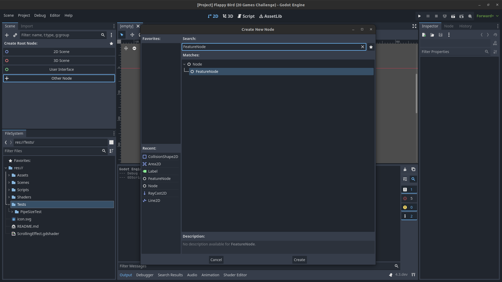
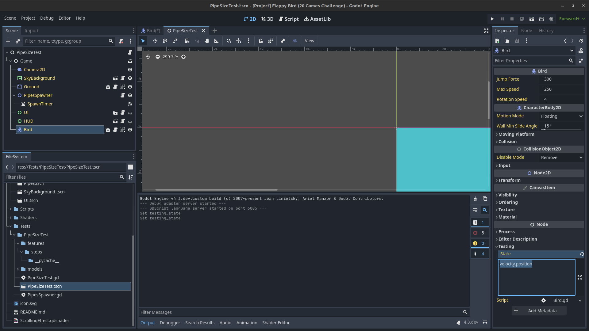

Godot Utilisation
=================

FeatureNode
-----------

The feature node is the root of a test. It is responsible of collecting the game state and handle actions.

Game State
----------

You can define which element in the game state you want to collect. By filling the `state` attribute of a node (you can do it with every type of node).

The game state will be sent to the agent at each step and it follows the same object structure as the node tree.